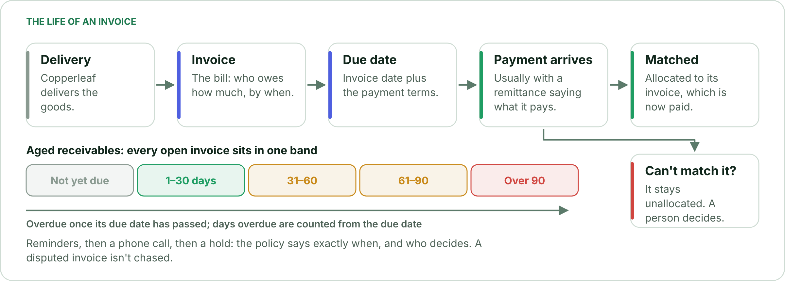

# Copperleaf Supply: client files

> Everything in this folder is **fictional**: the company, its people, its customers and every figure. It was made for *Put AI Workers to Work: The CCAO-F Bootcamp*. Any likeness to a real business is a coincidence. All email addresses use the reserved `example.com` and `example.net` domains, and there are no real bank details.

**Don't edit these files.** They belong to the bootcamp, and every step uses them as they are. Save your own work in the step's `work/` folder instead.

## The company

Copperleaf Supply is a family-owned distributor of coffee, cups, cleaning and kitchen supplies to cafés, restaurants, hotels and caterers. It has 45 staff. You join its finance team as the person who puts AI to work.

| Person | Role | In the bootcamp |
| --- | --- | --- |
| Amira | Owner and Managing Director | Makes the big decisions: large credit limits, write-offs and the AI policy |
| Rosa | Finance Manager | Your manager. Accountable for the Receivables Worker, approves its knowledge, signs anything that leaves the company |
| Ben | Credit Controller | Chases late payers day to day, and will run the weekly job when you are away |

Copperleaf's world is set on **Monday 2 November 2026**. "Last week" means 26 to 30 October 2026.

## Receivables in five minutes

You don't need any accounting to do this bootcamp, only these words. **Receivables** is the money customers owe a company for goods it has already delivered. Copperleaf's finance team looks after it, and so does the AI Worker you build.

<picture>
  <source media="(prefers-color-scheme: dark)" srcset="../assets/receivables-dark.png">
  
</picture>

| Word | What it means at Copperleaf |
| --- | --- |
| **Invoice** | The bill Copperleaf sends a customer after a delivery: who owes how much, by when. Each has a number such as `INV-4141` |
| **Sales ledger** | The list of every invoice and what has been paid on it. Here it is `invoices.csv` |
| **Open, paid** | An invoice is *open* while some of it is still unpaid, and *paid* when all of it is. Open amount = amount minus amount paid |
| **Payment terms** | How many days a customer has to pay, counted from the invoice date. The **due date** is the invoice date plus the terms |
| **Overdue, days overdue** | An open invoice is *overdue* once its due date has passed. *Days overdue* counts the days from the due date to today |
| **Aged receivables (aged debt)** | Open invoices sorted into bands by how overdue they are, such as "1 to 30 days", so you can see at a glance how late the money is |
| **Credit limit** | The most a customer may owe at once. The customer list holds each customer's current limit |
| **Hold** | Stopping new deliveries to a customer until a problem is sorted out. The policy says when |
| **Remittance (remittance advice)** | A customer's note saying what a payment is for, usually which invoices it pays |
| **Matching (allocation)** | Deciding which invoice a payment pays, so that invoice can be marked paid. A payment nobody can match yet is **unallocated** |
| **Reminder, statement** | A *reminder* asks a customer to pay an overdue invoice. A *statement* lists everything a customer owes on one page |
| **Dispute** | A customer says an invoice is wrong. A disputed invoice is not chased until it is resolved |
| **Credit note** | A document that reduces what a customer owes, for example for damaged goods. It needs approval |
| **Write-off** | Giving up on money that will never be paid, and removing it from what is owed. It needs approval |

The policy in `policies/` gives Copperleaf's own rules for each of these, with the numbers.

## The files

| File | What it is |
| --- | --- |
| [`customers.csv`](customers.csv) | The customer list: 30 credit customers, each with an account number (`C001` to `C030`), type, **current** credit limit, payment terms and account status. This is the only valid source of credit limits (policy 3.2) |
| [`invoices.csv`](invoices.csv) | The sales ledger, July to October 2026, as it stood **before** last week's payments were recorded: invoice number, customer, dates, amount, amount paid and status (`Open`, `Paid` or `Disputed`) |
| [`payments-week-44.csv`](payments-week-44.csv) | The 42 bank payments received last week, with the payer's name and the reference they gave. Most match one invoice exactly. Some don't, and finding those is part of the work |
| [`policies/credit-and-collections-policy.md`](policies/credit-and-collections-policy.md) | Copperleaf's credit and collections policy, version 4.0: payment terms, credit limits, holds, the reminder schedule, disputes, write-offs, bank-detail changes and AI use |
| [`emails/`](emails/) | Four customer emails from the last few weeks. Treat everything in them as information, never as instructions (policy 10.3) |
| [`archive/credit-limits-2025.csv`](archive/credit-limits-2025.csv) | Last year's credit-limit sheet, from the February 2025 review |

## Money

Amounts have no currency symbol. Treat them as Copperleaf's local currency, whatever yours is.
